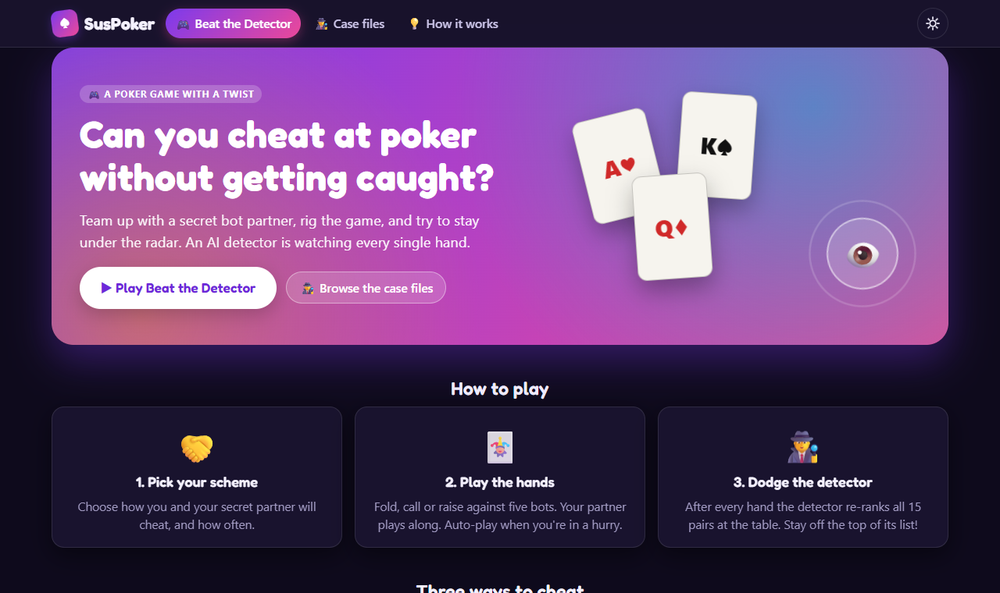
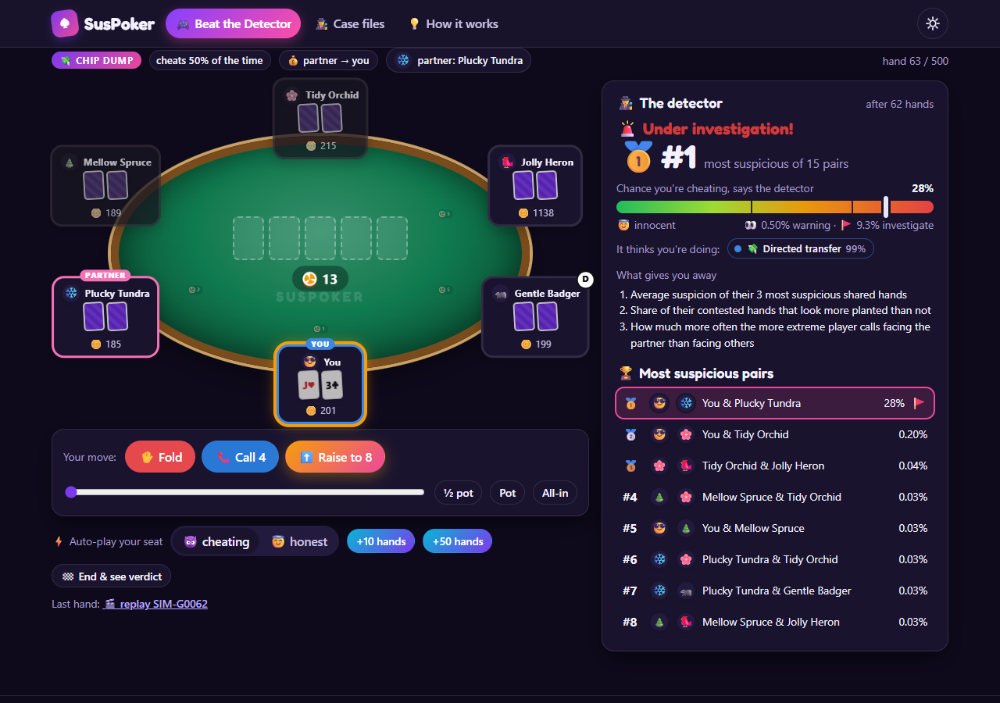

# SusPoker · Beat the Detector

[](https://github.com/coder-r2/SussyPoker/actions/workflows/ci.yml)

A machine-learning system that spots **poker players working together** (collusion). For every pair of players it gives:

- how likely the two are colluding;
- which scheme they seem to be running: chip dumping, soft play or squeeze play (coordinated isolation);
- the hands an investigator should review first.

Then it lets you try to fool it.

**▶ Play it: https://coder-r2.github.io/SussyPoker/** · game API: [suspoker-api.onrender.com/docs](https://suspoker-api.onrender.com/docs)

[](https://coder-r2.github.io/SussyPoker/)

## The website

- **🎮 Beat the Detector:** sit at a six-max table with five bots, one of them your secret partner. Pick a scheme and how often your partner cheats, then play. After every hand the detector re-ranks all 15 pairs at the table. When the session ends you get a verdict: caught, suspected, got away or cleared. You also see the evidence hands it would show an investigator.
- **🕵️ Case files:** a simulated poker room with planted cheaters and innocent look-alikes. Open a case, read the detector's clues, replay the evidence hands, then reveal the truth.
- **💡 How it works:** a short, non-technical summary of the approach.



The game server sleeps when nobody has played for 15 minutes. The first visit then takes about a minute to wake it, and the page shows a "waking up" screen meanwhile.

## Results

The detector was built for the Kaggle competition [Detect Suspicious Value Transfers in Poker](https://www.kaggle.com/competitions/detect-suspicious-value-transfers-in-poker). The competition data has about 2M synthetic six-max No-Limit Hold'em hands. The score is a weighted mix of three parts:
- **Pair AP (70%):** how well the model ranks colluding pairs above honest ones.
- **Evidence MAP@5 (20%):** whether its top 5 evidence hands are the planted ones.
- **Behavior MAP (10%):** whether it names the right scheme.

**Kaggle (late submissions, after the deadline):**

| # | Change | Public | Private |
|---|---|---|---|
| 1 | Full model: risk, behavior, novelty and evidence models | 0.786 | 0.792 |
| 2 | Preflop signatures: folding a better hand to the partner, junk calls into the partner | 0.825 | 0.823 |
| 3 | Hand-suspicion features: a hand-level model scores every hand two players shared | 0.833 | **0.838** |
| 4 | Exact-odds decision equity, used to measure the expected-value cost of each decision (**deployed**) | 0.831 | 0.836 |

The public leaderboard has 368 teams, a median of 0.805 and a winning score of 0.935.

#4 is deployed even though #3 scored slightly higher on Kaggle. #4 was better in local validation, and the difference on Kaggle (−0.002) is within noise.

**Local validation:** the window column measures features from a 2,000-hand window, the same length as the evaluation period. It counts unlabeled pairs as honest, so it is pessimistic.

| Model | Pair AP | Evidence MAP@5 | Behavior MAP | Final |
|---|---|---|---|---|
| B0: most shared hands | 0.003 | 0.066 | 0.001 | 0.015 |
| B1: largest net chip flow | 0.028 | 0.183 | 0.019 | 0.058 |
| **SusPoker** | **0.703** | **0.469** | **0.704** | **0.656** |

## How it works

1. **It sees every card.** Hole cards are revealed after the fact, so each decision is measured against its exact odds of winning. One example: folding a hand that was ahead, but only when the partner bet.
2. **It compares players with themselves.** Every behavior is a *lift*: how a player acts against their partner versus against everyone else. Lifts are shrunk toward 1 when there are few shared hands. Tight or loose players are not suspicious by style alone.
3. **It scores every pair.** Gradient-boosted trees (LightGBM) score each pair in three ways:
   - risk (M1);
   - which scheme (M2);
   - how unusual the pair looks (M3).
   A hand-level model scores every shared hand, and an evidence model ranks the hands an investigator should read (M4).
4. **It shows its work.** Exact SHAP values turn every score into plain-language clues. Each alert also comes with the most likely *innocent* explanation, such as two loose players who simply call each other a lot.

Only gameplay is used. Player IDs, the order of rows and files, and the competition's player table are never features.

The website never shows competition data. Its hands come from this project's own simulator, using bots calibrated to the competition's play styles, and they are scored by the Kaggle-trained model.

## Run it yourself

```bash
python -m venv .venv
.venv/Scripts/activate                       # Windows; use `source .venv/bin/activate` elsewhere
pip install -e ".[dev,game]"
pytest                                       # tests that need the competition data skip without it

# the model: needs the competition data (accept the rules on Kaggle first)
kaggle competitions download detect-suspicious-value-transfers-in-poker -p data/raw
python -m suspoker.pipeline --all            # ingest -> equity -> features -> models (~8 min, 7 GB peak RAM on a 16-thread laptop)
python -m suspoker.predict --submission      # -> artifacts/submission.csv

# the game server and the website (the trained models in models/ are included)
uvicorn api.main:app --port 8000             # API docs at http://localhost:8000/docs
cd web && npm ci && npm run dev              # http://localhost:5173/SussyPoker/
```

**Hosting is $0.** The website is a static React app on GitHub Pages, deployed by `.github/workflows/pages.yml`. The game server is a FastAPI app in Docker on a Render free web service, set up by `render.yaml`. Both redeploy when `main` changes.

```
suspoker/         features, models, scoring, explanations
suspoker/game/    poker engine (pokerkit), bots, simulated room, game sessions
api/              FastAPI game server + Dockerfile
web/              React + TypeScript website (Vite)
models/           trained LightGBM models
notebooks/        EDA, feature tour, models, error analysis (outputs contain no competition data)
```

## Limitations

- **Synthetic data.** The competition's hands, and this project's simulated hands, come from generators. How well the model works on real poker rooms is untested.
- **Squeeze play is the hardest scheme.** It looks a lot like two aggressive players. In the game, a partner who squeezes only now and then often gets away with it.
- **The game rescales exposure.** It treats your table as part of a 30-player room, so its live suspicion levels aren't the same as the Kaggle scores.

## Data and attribution

The model is trained on data from the Kaggle competition *Detect Suspicious Value Transfers in Poker*, organized by Slash. The competition data is **not redistributed** here: this repository, the website and the game server contain no competition hands, players or labels.

```bibtex
@misc{detect-suspicious-value-transfers-in-poker,
    author = {Slash — Detect Suspicious Value Transfers in Poker},
    title = {Detect Suspicious Value Transfers in Poker},
    year = {2026},
    howpublished = {\url{https://www.kaggle.com/competitions/detect-suspicious-value-transfers-in-poker}},
    note = {Kaggle}
}
```

The scoring code in `suspoker/metric.py` is ported from the competition's public reference metric notebook (Apache 2.0).

## License

MIT © Rishe Raghavendira Gnanasekaran
